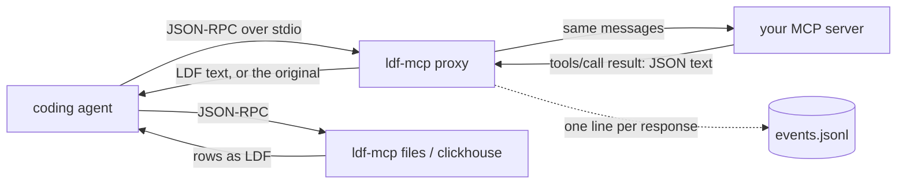

# LDF with coding agents

How LDF sits between a coding agent and its tools, which agent paths it can
reach today, and how to set it up. Facts about each agent come from its
official documentation or, where marked, its source code, checked on
2026-10-19 (Claude Code 2.1.303, Codex CLI rust-v0.163.0, OpenCode
v1.19.3).

## Five minutes with Claude Code

1. Get the binary: download `ldf-mcp` for your platform from the
   [latest release](https://github.com/caioricciuti/ldf/releases) and put it
   on your PATH, or `cargo install ldf-mcp`.
2. See what is there; nothing is changed:

   ```bash
   ldf-mcp doctor
   ldf-mcp install claude-code --wrap-all
   ```

   The plan lists every MCP server Claude Code has for this directory (local
   scope) and for you (user scope), and says which can be wrapped and why
   others are left alone.
3. Apply it. Either wrap your existing stdio servers, or add a files server
   over a directory of data, or both:

   ```bash
   ldf-mcp install claude-code --wrap-all --apply
   ldf-mcp install claude-code --add-files ./exports --apply
   ```

   Add `--model claude-opus-5-5` (or the model you use) to let the selector
   choose JSON or LDF per result from measured accuracy; without it LDF is
   used whenever it is shorter. `ldf-mcp doctor` lists the models with
   evidence.
4. Restart Claude Code and work as usual. Then:

   ```bash
   ldf-mcp stats
   ```

5. To undo: `ldf-mcp uninstall claude-code --apply`.

## How the data flows



`ldf-mcp proxy` forwards every message unchanged except three: it adds a
short LDF primer to the `initialize` instructions, one sentence to each tool
description, and re-encodes the text of a `tools/call` result when that text
is a JSON dataset (an array of objects, or an object holding one) and LDF is
shorter, or, with `--model`, when the selector accepts it for that model.
Everything else passes through byte for byte: errors, `isError` results,
images and other non-text content, `structuredContent`, notifications,
server-to-client requests, lines that are not JSON. A conversion that fails
or would not be shorter leaves the original text. `ldf-mcp files` and
`ldf-mcp clickhouse` are MCP servers of their own that read the data
directly and answer in LDF.

What `install` changes, for Claude Code: a wrapped server's entry
`{"command": "npx", "args": ["-y", "some-server"]}` becomes
`{"command": "/path/to/ldf-mcp", "args": ["proxy", "--name", "NAME", "--",
"npx", "-y", "some-server"]}`, written through `claude mcp remove` and
`claude mcp add-json` in the same scope. The original entry is recorded in
`installed.json` in the state directory (`~/.local/state/ldf` on Linux and
macOS, `%LOCALAPPDATA%\ldf` on Windows, or `LDF_STATE_DIR`). Running
install again changes nothing; `uninstall` restores each entry only if it
is still the one install wrote, and leaves anything you edited since alone.
If an add fails half way, the original is put back immediately.

Install wraps only stdio servers without `env` and without arguments that
look like credentials (containing key, token, secret, password, bearer or
auth), because the new entry passes through a command line. Those, remote
servers, and project-scoped `.mcp.json` servers (shared through version
control) are listed and left alone; wrap them by hand with the same
`proxy -- <original command>` shape if you want.

## Compatibility matrix

| Path to the model | Claude Code | Codex CLI | OpenCode |
|---|---|---|---|
| MCP tool results through `ldf-mcp proxy` | yes; `install claude-code` sets it up | partly: when a result carries `structuredContent`, Codex sends that and ignores the text LDF rewrote (source: `codex-rs/protocol/src/models.rs`); works for servers that return text, including `ldf-mcp files` and `clickhouse` | yes; OpenCode ignores `structuredContent` |
| `ldf-mcp files` / `clickhouse` as a server | yes | yes | yes |
| Configuration | `claude mcp add-json` / `remove`, scopes local, user, project | `~/.codex/config.toml` `[mcp_servers.NAME]` `command`, `args`; `codex mcp add NAME -- CMD` | `opencode.json` `"mcp": {"NAME": {"type": "local", "command": [...]}}` |
| A hook that can replace tool output | yes: `PostToolUse` returning `hookSpecificOutput.updatedToolOutput`, for MCP and built-in tools; built-in output must keep the tool's shape (Bash: `stdout`, `stderr`, `interrupted`, `isImage`) or it is ignored | no: `updatedMCPToolOutput` is documented as not supported yet; only `decision: "block"` replaces output, as blocked feedback capped near 2 500 tokens | yes: plugin hook `tool.execute.after`; for MCP tools the runtime object is the raw result (change `content[i].text`), for built-in tools `output.output` |
| Shell command output (curl, psql, `cat x.json`) | possible through the hook above (not built yet) | only by rewriting the command before it runs (`PreToolUse` `updatedInput`), which changes exit codes and stderr; not recommended | possible through the plugin hook (not built yet) |
| Built-in file read | the hook fires, but Read's output shape is not documented and a wrong shape is silently ignored: needs a test before use | no | possible through the plugin hook (not built yet) |
| Web fetch | as for file read | no (hooks do not fire on hosted tools) | possible through the plugin hook (not built yet) |
| Active model visible to LDF | no: pass `--model` at install | undocumented: `tools/call` `_meta` carries `x-codex-turn-metadata.model` (source) | no for MCP servers; plugins can look it up |
| Real usage counters | OpenTelemetry `claude_code.token.usage`, status line JSON | `TokenCount` events in `~/.codex/sessions/` | `opencode stats`, `opencode export` |

No integration intercepts every tool call. Through MCP, LDF sees only the
MCP servers it fronts or serves. Covering shell output, file reads and web
fetches needs each agent's hook or plugin system, which Codex does not offer
for output today.

## Codex CLI and OpenCode by hand

`install` does not configure these yet. The entries below are the
documented formats with the same proxy shape.

Codex, `~/.codex/config.toml`:

```toml
[mcp_servers.exports]
command = "/path/to/ldf-mcp"
args = ["files", "--root", "/path/to/exports", "--name", "exports"]

[mcp_servers.mydb]
command = "/path/to/ldf-mcp"
args = ["proxy", "--name", "mydb", "--", "npx", "-y", "some-mcp-server"]
```

Prefer servers that return plain text for Codex, as above.

OpenCode, `opencode.json` (project) or `~/.config/opencode/opencode.json`:

```json
{
  "mcp": {
    "exports": {
      "type": "local",
      "command": ["/path/to/ldf-mcp", "files", "--root", "/path/to/exports", "--name", "exports"]
    }
  }
}
```

## Measured on the demos

`python3 -I eval/demo_agents.py --root fixtures/medium` drives the proxy
and the files server over stdio the way an agent does and compares what the
model would receive (`docs/reports/2026-10-19-agent-demos/`):

| demo | call | JSON bytes | LDF bytes | ratio | JSON o200k | LDF o200k | ratio |
|---|---|---:|---:|---:|---:|---:|---:|
| A proxy | query rows=500 | 55348 | 30401 | 0.55 | 17289 | 10233 | 0.59 |
| A proxy | query rows=500 nested | 55392 | 31480 | 0.57 | 17303 | 10759 | 0.62 |
| D files | flat_users.csv | 69825 | 31400 | 0.45 | 23423 | 14203 | 0.61 |
| D files | nested_orders.json | 148056 | 67948 | 0.46 | 49981 | 32134 | 0.64 |
| D files | sparse_events.parquet | 127674 | 97246 | 0.76 | 42762 | 34375 | 0.80 |
| D files | wide_table.parquet | 270013 | 137408 | 0.51 | 117098 | 50849 | 0.43 |

Token ratios differ from byte ratios: JSON averages about 3.2 bytes per
o200k token here, LDF more, so `ldf-mcp stats`' `bytes / 4` estimate
understates the token saving on these runs (it reported about 82 600 where
o200k counts give about 115 300). These are serialization numbers in
OpenAI's tokenizer. They are not model usage: no agent and no model ran.

## Limitations

- Only MCP traffic is covered. Shell output, file reads and web fetches
  reach the model unchanged.
- `install` supports Claude Code only, wraps only stdio servers without env
  or credential-like arguments, and does not touch `.mcp.json`.
- Claude Code does not tell an MCP server which model is in use; `--model`
  is fixed at install and does not follow `/model`.
- Codex reads `structuredContent` when present, so a proxied server that
  sends it gets no saving there.
- Release binaries exist for macOS and Linux (arm64, x86-64). Windows is not
  built yet, and the proxy does not yet resolve `.cmd` launchers such as
  `npx.cmd` there.
- The token estimate in `stats` is bytes / 4; exact counts need a tokenizer
  (`ldf-bench count`) and real usage needs the agent's own counters.
- No model has been run through these integrations yet, so there is no
  measured end-to-end usage saving; the eval results in `docs/reports/`
  measure accuracy and tokens on prepared prompts, not agent sessions.

## Next milestone

1. A Claude Code `PostToolUse` hook (`ldf-mcp hook claude-code`) for Bash
   output that is a JSON dataset, keeping Bash's output shape, after a
   test of what Claude Code accepts; then Read and WebFetch if their shapes
   can be pinned.
2. `install codex` and `install opencode` writing the entries above, with
   the same record and rollback, and an OpenCode plugin file with no
   dependencies for built-in tool output.
3. Windows binaries in the release workflow, `.cmd` resolution in the proxy,
   and an install script that checks the SHA-256.
4. A measured agent session: the same scripted task with and without LDF,
   reading the agent's own token counters (needs approval; it uses a paid
   model).
