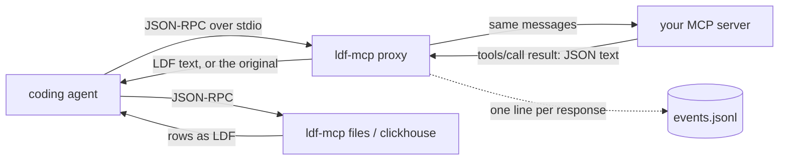

How LDF sits between a coding agent and its tools, which agent paths it can
reach today, and how to set it up. Facts about each agent come from its
official documentation or, where marked, its source code, checked on
2026-10-19 (Claude Code 2.1.303, Codex CLI rust-v0.163.0, OpenCode
v1.19.3); the Bash hook facts on 2026-10-20 against Claude Code 2.1.304.

## One command: JSON from shell commands, automatically

```bash
ldf-mcp install claude-code --hooks          # shows the plan, changes nothing
ldf-mcp install claude-code --hooks --apply  # adds the hook
```

From the next Claude Code session on, when a Bash command prints a JSON
dataset (`gh api`, `curl`, `kubectl -o json`, `cat export.json`), the model
reads it as LDF. Nothing else changes: you, the command and its exit status
see the same output as before. `ldf-mcp stats` shows what was converted and
why the rest was not; `ldf-mcp uninstall claude-code --apply` takes it out
again.

### How it works

`install --hooks` appends three handler groups to `hooks` in your user
settings (`~/.claude/settings.json`, or `$CLAUDE_CONFIG_DIR/settings.json`),
all running `ldf-mcp hook claude-code`:

| event | what the hook does |
|---|---|
| `PostToolUse`, matcher `Bash` | reads the tool result; if `stdout` is one complete JSON dataset and LDF is shorter, returns `hookSpecificOutput.updatedToolOutput`: the same result object with only `stdout` replaced, plus a short `additionalContext` note saying the command itself still prints JSON (and, once per context, the LDF primer). Otherwise prints nothing |
| `SessionStart` | records the session's model for the selector; after `/compact` or `/clear` it forgets that the primer was sent |
| `PostModelSwitch` | records the new model |

Claude Code checks a replacement against the Bash tool's output schema and
uses the original when it does not match, discards the output of a hook
that times out (10 seconds here) or exits with an error, and only runs
`PostToolUse` for commands that succeeded: a non-zero exit goes to
`PostToolUseFailure`, which cannot replace output. So the worst a broken
hook can do is nothing. The hook always exits 0, prints either one whole
JSON reply or nothing, makes no network calls and starts no processes.

The format is chosen per model from measured accuracy (the same selector as
`--model` on the MCP servers, [Choosing the format per
model](/docs/mcp/#choosing-the-format-per-model)). The model comes from
`SessionStart`, then `PostModelSwitch`, then, when Claude Code did not send
one (`claude -p` does not), the last `"model"` in the session transcript;
only that id is read and kept. A model without evidence gets JSON. Today
that means Opus 5.5 and Haiku 5.5 get LDF on the shapes they were measured
on, Sonnet 5.5 and GPT models get JSON. `install --hooks --model ID` fixes
the model instead.

A conversion is made only when LDF plus the note (and the primer, the
first time) is smaller than the JSON, so small outputs early in a session
stay JSON.

### What is converted and what is not

Converted: Bash stdout that is, as a whole, a JSON array of objects or an
object holding one (`{"items": [...]}`), at least 1 024 bytes (`--min-bytes`
on the hook command), compact or pretty.

Left alone, with the reason code `stats` shows:

| case | reason |
|---|---|
| plain text, logs, JSON with a line of prose before or after it, JSONL, truncated JSON | `not_json` |
| JSON that is not rows of objects (`[1,2,3]`, `{"ok": true}`) | `not_dataset` |
| under `--min-bytes`, or LDF plus its note not smaller | `small`, `not_shorter` |
| the selector keeps JSON for this model | `selector` |
| output over Claude Code's inline limit (30 000 characters by default, `BASH_MAX_OUTPUT_LENGTH`): Claude Code saves it to a file and shows the model a 2 KB preview; the hook sees an incomplete stdout | `persisted` |
| a non-zero exit Claude Code reported as success (`grep` with no match) | `exit_code` |
| interrupted, backgrounded, or image output | `interrupted`, `background`, `image` |
| a command containing `LDF_RAW=1` (`LDF_RAW=1 gh api repos/x/y`), for when the exact JSON text is needed | `raw` |
| a subagent whose model neither `--model` nor its own transcript names | `subagent` |
| failed commands | never reach the hook |

The note that comes with every conversion tells the model about
`LDF_RAW=1`, so it can ask for the JSON text itself when it has to copy
bytes exactly.

Subagents have their own context and may run another model than the main
thread (an Explore agent on Haiku under an Opus session). Their tool calls
carry the parent's `session_id` plus an `agent_id`, so the hook keeps a
separate primer flag per subagent and takes the subagent's model from
`--model` or the subagent's own transcript, never from the main thread.

Other tools (Read, WebFetch, MCP tools) are not touched by the hook; MCP
results are covered by `ldf-mcp proxy` below. The two are independent:
`--hooks` and `--wrap` can be used alone or together.

### Installing next to other hooks

The settings file is parsed and written back with its key order kept;
other keys and other hooks (an `rtk` or policy hook on `PreToolUse` or
`PostToolUse`) stay where they are. Before writing, a copy of the file goes
to the state directory (`settings.json.before-<time>`), and each added group
is recorded in `installed.json`. Running install again changes nothing.
`uninstall` removes only groups that are still exactly what install added,
and leaves anything you edited since alone; settings you changed elsewhere
in the file survive. An unreadable settings file is refused, unchanged.

Claude Code runs sibling hooks in parallel on the original output and the
last replacement wins. This hook never returns an unchanged copy, so it
cannot undo another hook's rewrite when it does not convert; but when it
does convert, its LDF is made from the original output, and a sibling hook
that redacts Bash output can lose the race. `install --hooks` and `doctor`
warn when another `PostToolUse` group in the user or project settings
matches Bash; hooks from plugins are not visible to them. A `PreToolUse` hook that rewrites the command (rtk turns
`cat x.json` into `rtk read x.json`) runs first; whatever that command then
prints is what this hook sees.

### Security and correctness

- stdout is treated as untrusted input: it is parsed, never executed, and
  input over 16 MiB is not read. A parse failure is a passthrough.
- The conversion is lossless at the semantic level: the LDF decodes back to
  the same records, except that keys moved into the sparse `~` object may
  come back in a different order within a record (`semantic-unordered`,
  [spec section 7](/docs/spec/)).
- The model is told in the note that the command prints JSON, so scripts it
  writes against the command keep parsing JSON. What you see in the
  terminal transcript is Claude Code's record of the original output.
- `updatedToolOutput` changes only what the model reads. Telemetry and the
  transcript record the original (Claude Code documentation).
- Statistics hold sizes, reason codes, time and the model id; never the
  command, its arguments, the output or the session id.
- Per-session state is small files under `claude-code/sessions` in the
  state directory (the model id, and an empty marker for the primer per
  context: the main thread and each subagent), removed after 30 days. The
  marker is written only after the reply carrying the primer was written
  whole. The primer travels in `additionalContext`, which Claude Code
  delivers even when another hook's rewrite wins, and which it replays
  when a session is resumed; after compaction the marker is dropped and
  the primer sent again.
- A symlinked `settings.json` (dotfiles) is written where the link points;
  the link stays.

### Measured

`python3 -I eval/bench_hook.py` runs the release binary the way Claude
Code does, one process per call, on the first 20 and 100 records of the
twelve medium fixtures, printed compact and pretty
(`reports/2026-10-20-hook/`, Apple M2 Pro). Tokens are exact o200k counts of
what the model reads, note and primer included; Claude's tokenizer is not
public, so no Claude counts are claimed.

| model setting | inputs | inline | converted | o200k after / JSON, converted only | later calls | first call (primer) |
|---|---:|---:|---:|---|---:|---:|
| Opus 5.5 | 48 | 40 | 20 | 0.31 to 0.89 | 0.58 | 0.66 |
| Haiku 5.5 | 48 | 40 | 19 | 0.31 to 0.89 | 0.58 | 0.66 |
| Sonnet 5.5 | 48 | 40 | 0 | | 1.00 | 1.00 |
| no selector (`LDF when shorter`) | 48 | 40 | 31 | 0.23 to 0.89 | 0.55 | 0.63 |

Examples (Opus 5.5, later calls): 100 users printed pretty, 7 384 to 2 907
tokens; 20 rows of a wide table, 7 026 to 2 189; 100 sparse events
compact, 5 565 to 4 397. Each invocation took 4.4 to 8.9 ms wall time with
process start (p50), 0.1 to 2.6 ms of it inside the hook.

On provider-reported usage, `python3 -I eval/ab_hook.py` runs the same
headless Claude Code task with and without the hook: `cat data.json`, then
two questions with answers computed from the data, three repeats per case
(`reports/2026-10-20-hook/ab-haiku/`, Haiku 5.5, 36 runs, $0.076). "Added"
is what the tool call put into the next request's prompt, in Claude tokens
as Anthropic reported them (tool result, note and primer included):

| case | JSON bytes | added, JSON | added, hook | hook / JSON | correct, JSON | correct, hook |
|---|---:|---:|---:|---:|---:|---:|
| 100 users, pretty | 19 206 | 9 478 | 4 580 | 0.48 | 6/6 | 6/6 |
| 100 log lines, pretty | 19 353 | 9 114 | 4 622 | 0.51 | 6/6 | 6/6 |
| 20 wide rows, pretty | 15 810 | 8 055 | 3 324 | 0.41 | 6/6 | 6/6 |
| 100 sparse events, pretty | 20 927 | 10 367 | 6 452 | 0.62 | 6/6 | 6/6 |
| 100 unicode rows, compact | 12 950 | 6 810 | 4 395 | 0.65 | 6/6 | 6/6 |
| 20 nested orders (selector keeps JSON) | 5 998 | 3 083 | 3 083 | 1.00 | 6/6 | 6/6 |
| all | | 46 907 | 26 456 | 0.56 | 36/36 | 36/36 |

Opus 5.5 on the same 36 runs (`reports/2026-10-20-hook/ab-opus/`, $3.09):
46 899 against 26 463 added tokens, 0.56 again, per case 0.41 to 0.65 where
converted and 1.00 on the nested control, 36 of 36 correct in both arms.

These are the first billed-usage numbers: on these tasks the hook cut the
tokens a tool result costs by 35 to 59 percent on both models, with no
answer lost. The
per-run cost was lower with the hook too, but run order affects prompt
caching (the JSON arm ran first), so the cost column is not a clean
comparison; the token columns are. Short tasks, small n: it
shows the mechanism pays, not a general saving for every session.

## Five minutes with Claude Code: MCP servers

1. Get the binary: download `ldf-mcp` for your platform from the
   [latest release](https://github.com/caioricciuti/ldf/releases) and put it
   on your PATH, or `cargo install ldf-mcp`.
2. See what is there; nothing is changed:

   ```bash
   ldf-mcp doctor
   ldf-mcp install claude-code --wrap-all
   ```

   The plan lists every MCP server Claude Code has for this directory (local
   scope) and for you (user scope), and says which can be wrapped and why
   others are left alone.
3. Apply it. Either wrap your existing stdio servers, or add a files server
   over a directory of data, or both:

   ```bash
   ldf-mcp install claude-code --wrap-all --apply
   ldf-mcp install claude-code --add-files ./exports --apply
   ```

   Add `--model claude-opus-5-5` (or the model you use) to let the selector
   choose JSON or LDF per result from measured accuracy; without it LDF is
   used whenever it is shorter. `ldf-mcp doctor` lists the models with
   evidence.
4. Restart Claude Code and work as usual. Then:

   ```bash
   ldf-mcp stats
   ```

5. To undo: `ldf-mcp uninstall claude-code --apply`.

## How the data flows



`ldf-mcp proxy` forwards every message unchanged except three: it adds a
short LDF primer to the `initialize` instructions, one sentence to each tool
description, and re-encodes the text of a `tools/call` result when that text
is a JSON dataset (an array of objects, or an object holding one) and LDF is
shorter, or, with `--model`, when the selector accepts it for that model.
Everything else passes through byte for byte: errors, `isError` results,
images and other non-text content, `structuredContent` (except FastMCP's
`{"result": S}` wrapping of the same text, which follows the rewritten
text), notifications, server-to-client requests, lines that are not JSON. A conversion that fails
or would not be shorter leaves the original text. `ldf-mcp files` and
`ldf-mcp clickhouse` are MCP servers of their own that read the data
directly and answer in LDF.

What `install` changes, for Claude Code: a wrapped server's entry
`{"command": "npx", "args": ["-y", "some-server"]}` becomes
`{"command": "/path/to/ldf-mcp", "args": ["proxy", "--name", "NAME", "--",
"npx", "-y", "some-server"]}`, written through `claude mcp remove` and
`claude mcp add-json` in the same scope. The original entry is recorded in
`installed.json` in the state directory (`~/.local/state/ldf` on Linux and
macOS, `%LOCALAPPDATA%\ldf` on Windows, or `LDF_STATE_DIR`). Running
install again changes nothing; `uninstall` restores each entry only if it
is still the one install wrote, and leaves anything you edited since alone.
If an add fails half way, the original is put back immediately.

Install wraps only stdio servers without `env` and without arguments that
look like credentials (containing key, token, secret, password, bearer or
auth), because the new entry passes through a command line. Those, remote
servers, and project-scoped `.mcp.json` servers (shared through version
control) are listed and left alone; wrap them by hand with the same
`proxy -- <original command>` shape if you want.

## Compatibility matrix

| Path to the model | Claude Code | Codex CLI | OpenCode |
|---|---|---|---|
| MCP tool results through `ldf-mcp proxy` | yes; `install claude-code` sets it up. Claude Code also shows the model `structuredContent` when present (seen in 2.1.306 transcripts), so a server whose `structuredContent` is not FastMCP's `{"result": S}` wrapping gets no saving | partly: when a result carries `structuredContent`, Codex sends that and ignores the text LDF rewrote (source: `codex-rs/protocol/src/models.rs`); works for servers that return text, including `ldf-mcp files` and `clickhouse` | yes; OpenCode ignores `structuredContent` |
| `ldf-mcp files` / `clickhouse` as a server | yes | yes | yes |
| Configuration | `claude mcp add-json` / `remove`, scopes local, user, project | `~/.codex/config.toml` `[mcp_servers.NAME]` `command`, `args`; `codex mcp add NAME -- CMD` | `opencode.json` `"mcp": {"NAME": {"type": "local", "command": [...]}}` |
| A hook that can replace tool output | yes: `PostToolUse` returning `hookSpecificOutput.updatedToolOutput`, for MCP and built-in tools; a built-in replacement must pass the tool's output schema or it is ignored. Bash's result carries more than the documented `stdout`, `stderr`, `interrupted`, `isImage` (also `returnCodeInterpretation`, `noOutputExpected`, `backgroundTaskId`, `persistedOutputPath` and others, source), so the hook copies it whole and replaces `stdout` | no: `updatedMCPToolOutput` is documented as not supported yet; only `decision: "block"` replaces output, as blocked feedback capped near 2 500 tokens | yes: plugin hook `tool.execute.after`; for MCP tools the runtime object is the raw result (change `content[i].text`), for built-in tools `output.output` |
| Shell command output (curl, psql, `cat x.json`) | yes: `install claude-code --hooks` (JSON datasets in Bash stdout, inline size only) | only by rewriting the command before it runs (`PreToolUse` `updatedInput`), which changes exit codes and stderr; not recommended | possible through the plugin hook (not built yet) |
| Built-in file read | the hook fires, but Read's output shape is not documented and a wrong shape is silently ignored: needs a test before use | no | possible through the plugin hook (not built yet) |
| Web fetch | as for file read | no (hooks do not fire on hosted tools) | possible through the plugin hook (not built yet) |
| Active model visible to LDF | MCP: no, pass `--model` at install. Hooks: `SessionStart` input carries `model` (not in `-p`), `PostModelSwitch` carries `to_model`, the transcript names it | undocumented: `tools/call` `_meta` carries `x-codex-turn-metadata.model` (source) | no for MCP servers; plugins can look it up |
| Real usage counters | OpenTelemetry `claude_code.token.usage`, status line JSON | `TokenCount` events in `~/.codex/sessions/` | `opencode stats`, `opencode export` |

No integration intercepts every tool call. Through MCP, LDF sees only the
MCP servers it fronts or serves; the Claude Code hook covers Bash. File
reads and web fetches need each agent's hook or plugin system, which Codex
does not offer for output today.

## Codex CLI and OpenCode by hand

`install` does not configure these yet. The entries below are the
documented formats with the same proxy shape.

Codex, `~/.codex/config.toml`:

```toml
[mcp_servers.exports]
command = "/path/to/ldf-mcp"
args = ["files", "--root", "/path/to/exports", "--name", "exports"]

[mcp_servers.mydb]
command = "/path/to/ldf-mcp"
args = ["proxy", "--name", "mydb", "--", "npx", "-y", "some-mcp-server"]
```

Prefer servers that return plain text for Codex, as above.

OpenCode, `opencode.json` (project) or `~/.config/opencode/opencode.json`:

```json
{
  "mcp": {
    "exports": {
      "type": "local",
      "command": ["/path/to/ldf-mcp", "files", "--root", "/path/to/exports", "--name", "exports"]
    }
  }
}
```

## Measured on the demos

`python3 -I eval/demo_agents.py --root fixtures/medium` drives the proxy
and the files server over stdio the way an agent does and compares what the
model would receive (`reports/2026-10-19-agent-demos/`):

| demo | call | JSON bytes | LDF bytes | ratio | JSON o200k | LDF o200k | ratio |
|---|---|---:|---:|---:|---:|---:|---:|
| A proxy | query rows=500 | 55348 | 30401 | 0.55 | 17289 | 10233 | 0.59 |
| A proxy | query rows=500 nested | 55392 | 31480 | 0.57 | 17303 | 10759 | 0.62 |
| D files | flat_users.csv | 69825 | 31400 | 0.45 | 23423 | 14203 | 0.61 |
| D files | nested_orders.json | 148056 | 67948 | 0.46 | 49981 | 32134 | 0.64 |
| D files | sparse_events.parquet | 127674 | 97246 | 0.76 | 42762 | 34375 | 0.80 |
| D files | wide_table.parquet | 270013 | 137408 | 0.51 | 117098 | 50849 | 0.43 |

Token ratios differ from byte ratios: JSON averages about 3.2 bytes per
o200k token here, LDF more, so `ldf-mcp stats`' `bytes / 4` estimate
understates the token saving on these runs (it reported about 82 600 where
o200k counts give about 115 300). These are serialization numbers in
OpenAI's tokenizer. They are not model usage: no agent and no model ran.

## Limitations

- Claude Code: MCP results (proxy) and Bash stdout (hook) are covered. File
  reads, web fetches and Bash output over the inline limit reach the model
  unchanged. Other agents: MCP only.
- The hook converts only output Claude Code shows inline (30 000
  characters by default). Larger output is saved to a file by Claude Code
  before the hook runs and stays JSON; the model later reads that file
  with Read, which the hook does not touch.
- `install` supports Claude Code only, wraps only stdio servers without env
  or credential-like arguments, and does not touch `.mcp.json`.
- Claude Code does not tell an MCP server which model is in use; `--model`
  is fixed at install and does not follow `/model`. The hook does follow
  it.
- Codex and Claude Code read `structuredContent` when present. The proxy
  rewrites it only in FastMCP's `{"result": S}` form; a server that sends
  any other `structuredContent` gets no saving there.
- Release binaries cover macOS and Linux (arm64, x86-64) and Windows
  x86-64 (a zip; Windows on Arm runs it under emulation). There is no
  install script yet: download, check the `.sha256`, and put the binary on
  your PATH.
- The token estimate in `stats` is bytes / 4; exact counts need a tokenizer
  (`ldf-bench count`) and real usage needs the agent's own counters.
- The usage A/B covers Haiku 5.5 and Opus 5.5 on six short tasks; long
  sessions and Sonnet are not measured. The eval results in `reports/` measure accuracy and tokens
  on prepared prompts, not agent sessions.

## Next milestone

1. Read and WebFetch through the same hook, if their output shapes can be
   pinned against the binary as Bash's was.
2. `install codex` and `install opencode` writing the entries above, with
   the same record and rollback, and an OpenCode plugin file with no
   dependencies for built-in tool output.
3. An install script that picks the right archive and checks its SHA-256.
4. A measured agent session: the same scripted task with and without LDF,
   reading the agent's own token counters (needs approval; it uses a paid
   model).
